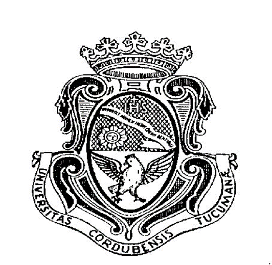
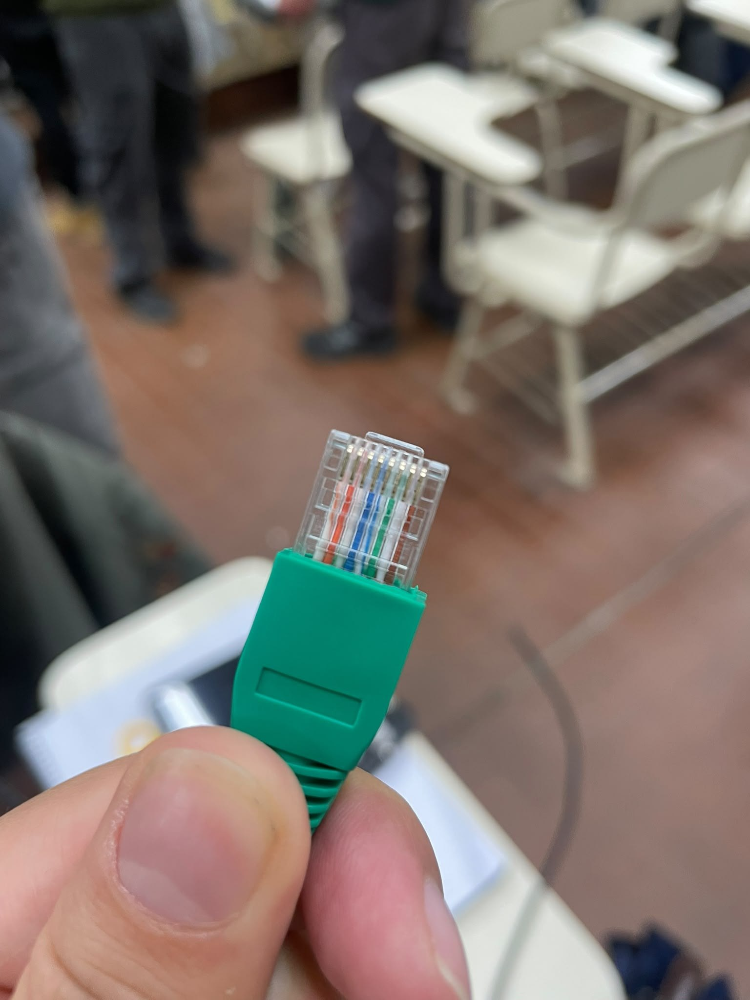
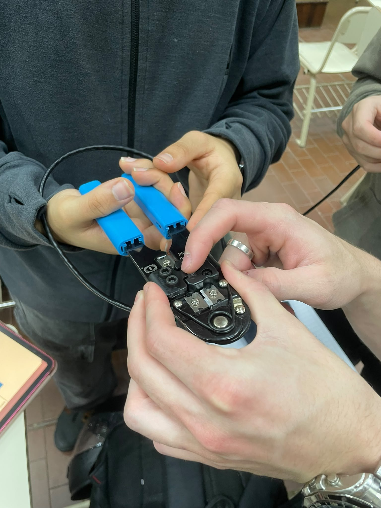
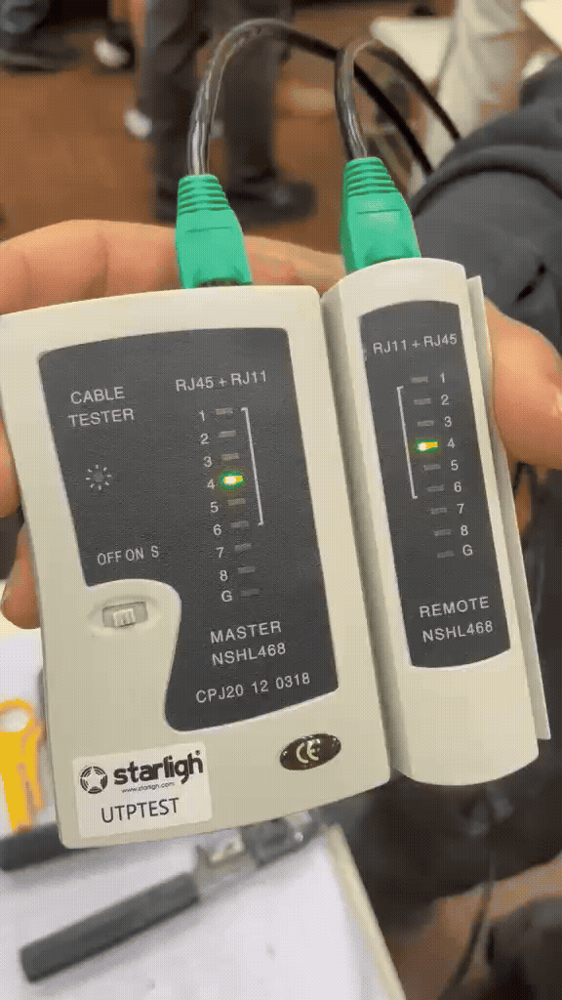
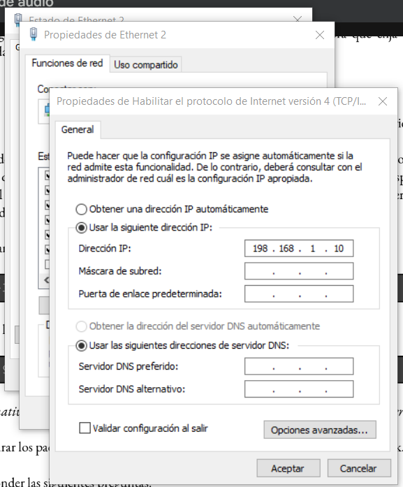
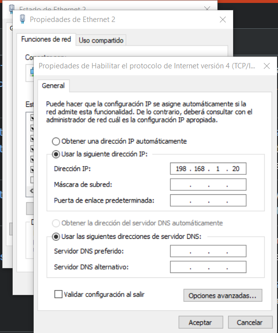
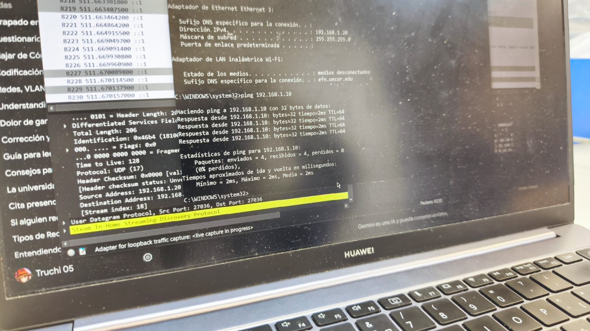
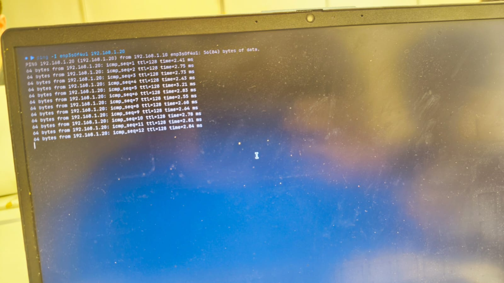
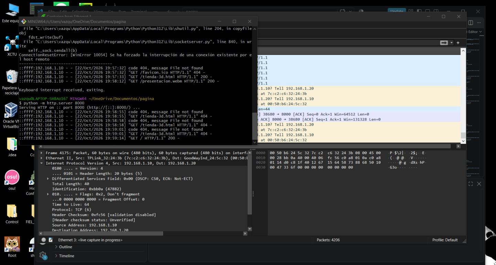

# Universidad Nacional de Córdoba
### Facultad de Ciencias Exactas, Físicas y Naturales

# Redes de Computadoras
## Trabajo Práctico Nº 6 - Laboratorio: Construcción de cable UTP y conexión en red LAN

| | |
|---|---|
| **Comisión** | ICOMP 24-3 |
| **Docente** | Oliva, Facundo |
| **Año** | 2026 |

**Alumnos:**
- Lamas, Matías Angel
- Torres Sosa, Candelaria
- Baiutti, Bruno Augusto
- Sanchez Oliveto, Juan Cruz
- Vazquez Zuloeta, Fabian
- Pinque, Emanuel Leandro
- Mayne, William Annesley

---

## Parte 1) Construcción de cable UTP (Norma T568B)

El armado de un cable de red de transmisión directa, también conocido como cable derecho, es un procedimiento técnico fundamental en las telecomunicaciones que garantiza la correcta transmisión de datos entre dispositivos como computadoras, switches y routers. Este proceso se rige bajo la norma internacional ANSI/TIA/EIA-568, la cual define el esquema exacto de distribución y orden de los cables dentro de los conectores. La norma contempla dos variantes principales para el código de colores: T568A y T568B. Ambas ofrecen exactamente el mismo rendimiento técnico y ancho de banda, diferenciándose únicamente en el intercambio de posiciones entre el par verde y el par naranja. Para armar un cable directo, la regla básica es replicar el mismo estándar en ambos extremos del cable, siendo el esquema T568B el más utilizado en la industria.

### Procedimiento de crimpado de cable de red RJ-45

#### Materiales necesarios
* Cable de par trenzado UTP categoría 5e o 6
* Dos conectores RJ-45 transparentes
* Pinza crimpadora o ponchadora para conectores de 8 pines
* Pelacables o la cuchilla de la crimpadora
* (Opcional) Comprobador o tester de cables LAN

#### Desarrollo

1. **Preparación del cable:**
   Con el pelacables o la cuchilla de la crimpadora, retiramos unos 3 cm del revestimiento exterior de plástico de un extremo del cable. Tuvimos cuidado de no mellar ni cortar el aislamiento de los ocho hilos de cobre internos. Luego separamos y destrenzamos con cuidado los cuatro pares de hilos.

2. **Organización de los hilos (norma T568B):**
   Ordenamos los hilos en una tira plana, de izquierda a derecha, según esta secuencia:

   | Posición | Color |
   |:---:|---|
   | **1** | Blanco / naranja |
   | **2** | Naranja |
   | **3** | Blanco / verde |
   | **4** | Azul |
   | **5** | Blanco / azul |
   | **6** | Verde |
   | **7** | Blanco / marrón |
   | **8** | Marrón |

   Sostuvimos la tira firmemente, cerca del borde de la cubierta externa. Cortamos la punta del manojo a 90 grados con la navaja recta de la crimpadora, dejando los hilos con una longitud uniforme de 1,2 a 1,4 cm. Esta medida es crítica: los hilos deben llegar hasta el fondo del conector, y la funda exterior tiene que entrar lo suficiente para quedar sujeta por el mecanismo de retención del RJ-45.

3. **Inserción en el conector:**
   Tomamos el conector RJ-45 con la pestaña de fijación hacia abajo y los contactos dorados hacia arriba. Introducimos los ocho hilos alineados.

   

   Empujamos suavemente hasta verificar, a través del plástico transparente, que cada hilo llegó al fondo del conector y que el orden de colores no se alteró.

4. **Crimpado:**
   Insertamos el conector en la ranura correspondiente de la pinza crimpadora y presionamos firmemente los mangos hasta completar todo el recorrido del mecanismo.

   

   Durante este paso, las cuchillas empujan los contactos metálicos para perforar la funda de cada hilo y establecer contacto eléctrico. Al mismo tiempo, una pestaña plástica sujeta la cubierta exterior del cable para resistir tirones. Repetimos exactamente el mismo procedimiento en el extremo opuesto, manteniendo el esquema T568B.

5. **Verificación:**
   Probamos ambos extremos en el tester de red. Si el crimpado es correcto, los ocho LED se encenderán en secuencia, en el mismo orden, en ambos lados, como se muestra a continuación.

   

---

## Parte 2) Levantamiento y testeo de la Red LAN

### 1) Configuración manual de la interfaz de red

* **a) Configuración de la dirección IPv4:** 
  Se asigna una dirección estática dentro del rango privado de clase C, configurando `192.168.1.10` para la primera máquina y `192.168.1.20` para la segunda.
* **b) Configuración de la máscara de subred:** 
  Se establece la máscara por defecto para este tipo de redes locales: `255.255.255.0`, lo que define que los primeros 24 bits corresponden a la red y los 8 restantes a los hosts.
* **c) Configuración de la puerta de enlace predeterminada (Default Gateway):** 
  En este caso no se configura la gateway ya que no se utiliza un router, dado que toda la comunicación se realiza de forma directa mediante cable UTP y un switch.

---

### 2) Conexión física y prueba de conectividad (Ping)

* Conectar físicamente cada computadora al switch utilizando el cable UTP directo confeccionado previamente.
* Verificar mediante el comando `ping` desde una computadora hacia la IP de la otra que exista conectividad bidireccional exitosa.

---

### 3) Transmisión UDP con Packet Sender y Wireshark

Se optó por utilizar Packet Sender por la facilidad que ofrece su interfaz gráfica y su rapidez. En las imágenes se observa el envío de paquetes UDP desde la IP `.20` hacia la `.10` a través del puerto `33051`:

.jpeg)

Aquí se visualiza la recepción del paquete UDP enviado:

.jpeg)

En esta captura de pantalla de Wireshark podemos examinar cómo viajan los paquetes y apreciar asimismo el protocolo ARP, el cual se utiliza para completar la tabla propia de direcciones MAC de la PC:

.jpeg)

---

### Cuestionario sobre UDP

* **a) ¿Se observa algún procedimiento de establecimiento de conexión antes de enviar los datos?**
  No. A diferencia de TCP, el protocolo UDP es orientado a la rapidez. Al enviar paquetes con Packet Sender, no se realiza ningún intercambio preliminar de control. El primer datagrama transmitido por la red contiene directamente los datos dentro de su carga útil.

* **b) ¿Existe algún mecanismo de confirmación de recepción equivalente a los ACK de TCP?**
  No. UDP no provee confiabilidad nativa ni acuse de recibo. El emisor coloca el datagrama en el medio de red y no recibe ningún tipo de respuesta por parte del protocolo que le confirme si el receptor llegó a leer o recibir la información.

* **c) ¿Qué ocurre si se envían mensajes mientras el receptor UDP no está ejecutándose?**
  Si el receptor no está activo, el emisor enviará los datagramas de todas formas, pero el sistema operativo del receptor los descartará. En algunos casos, el kernel del destino envía un mensaje de error ICMP de tipo **Destination Unreachable (Port Unreachable)** de vuelta al origen, pero el emisor UDP por sí solo no reintenta ni notifica a la aplicación.

* **d) ¿UDP garantiza que los mensajes lleguen en el mismo orden en que fueron enviados?**
  No. UDP no incluye números de secuencia en su encabezado. Cada datagrama se trata como una unidad de información completamente independiente y enrutada por separado. Si los paquetes atraviesan diferentes rutas o sufren retardos por congestión, pueden llegar desordenados o duplicados al destino sin que UDP pueda reordenarlos.

* **e) ¿Qué aplicaciones reales utilizan UDP y por qué?**
  * **Streaming en tiempo real:** Se prefiere la velocidad y la mínima latencia por sobre la confiabilidad absoluta. Perder un cuadro de video o un milisegundo de audio es preferible antes que congelar la transmisión para esperar una retransmisión.
  * **Juegos en línea multijugador:** Donde la inmediatez de las acciones del jugador y el estado del juego se actualizan constantemente de forma muy rápida.
  * **Consultas DNS y DHCP:** Son mensajes pequeños de tipo pregunta-respuesta de un solo datagrama.

### 4) Capturar el tráfico generado con Wireshark. ¿De qué tipo es?

  El tráfico generado corresponde a TCP en la Capa de Transporte y HTTP en la Capa de Aplicación.

  1. **Establecimiento de Conexión (Three-Way Handshake TCP):** El cliente y el servidor se conectan mediante el intercambio de los segmentos SYN, SYN, ACK y ACK utilizando el puerto del servidor (por ejemplo, el puerto 8000).
  2. **Petición HTTP :** El cliente envía una solicitud de tipo GET /archivo.pdf HTTP/1.1 para requerir el archivo alojado.
  3. **Respuesta HTTP :** El servidor responde con el código de estado HTTP/1.1 200 OK, acompañado de sus respectivas cabeceras de metadatos y la transmisión efectiva del contenido del archivo fragmentado en múltiples segmentos TCP, confirmados por el cliente mediante paquetes ACK.
  4. **Cierre de Conexión:** Una vez completada la transferencia del archivo, se ejecuta el cierre ordenado de la sesión mediante el intercambio de segmentos FIN, ACK y ACK.

