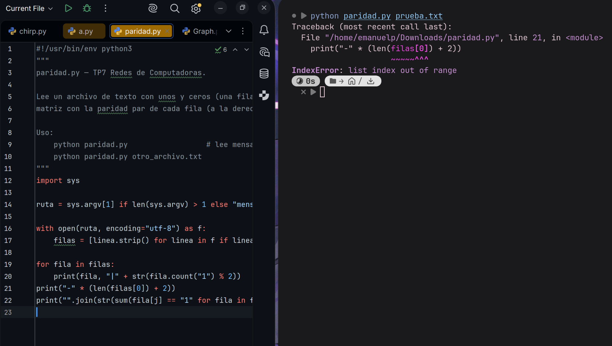
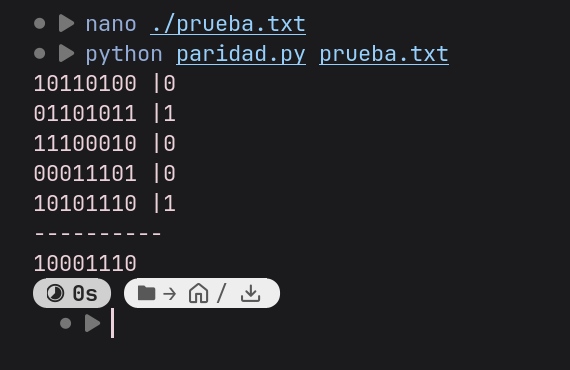
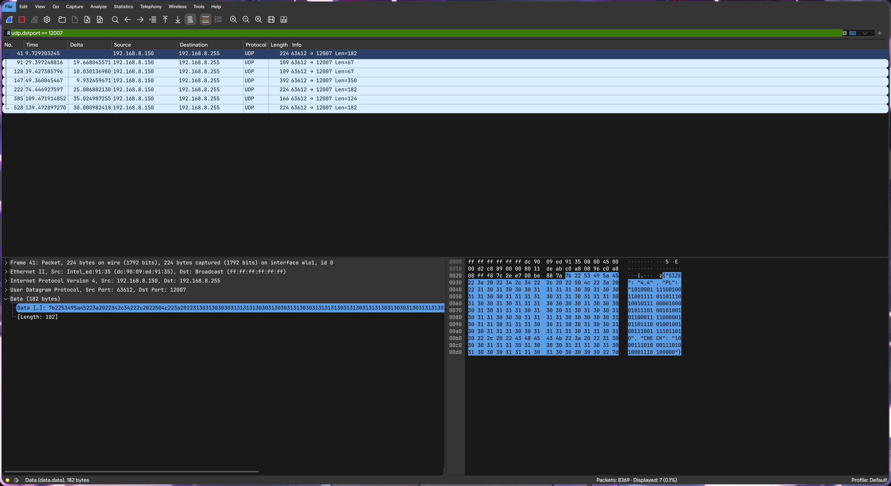
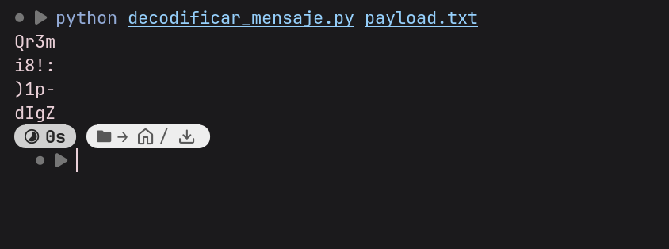
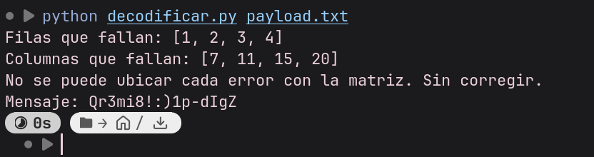
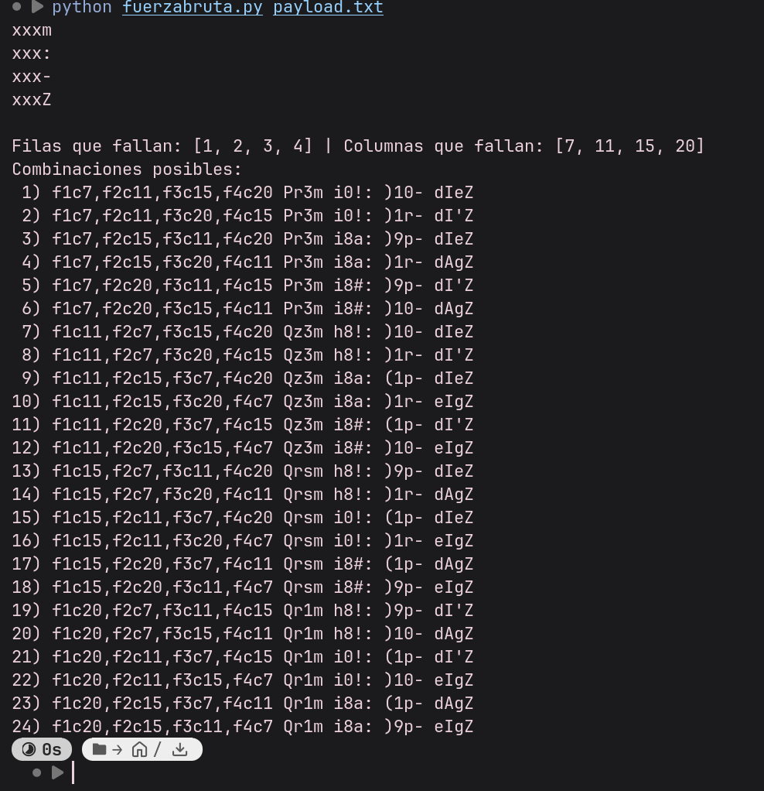

# Universidad Nacional de Córdoba
### Facultad de Ciencias Exactas, Físicas y Naturales


# Redes de Computadoras
## Trabajo Práctico N° 7 — Desafío final: captura, de-codificación y recuperación de datos en redes de computadoras

| | |
|---|---|
| **Comisión** | ICOMP 24-3 |
| **Docente** | Oliva, Facundo |
| **Año** | 2026 |

**Alumnos:**
- Lamas, Matías Angel
- Torres Sosa, Candelaria
- Baiutti, Bruno Augusto
- Sanchez Oliveto, Juan Cruz
- Vazquez Zuloeta, Fabian
- Pinque, Emanuel Leandro
- Mayne, William Annesley

---

## Índice

1. [Introducción](#1-introducción)
2. [Preparando el entorno](#2-preparando-el-entorno)
3. [Desarrollo del desafío](#3-desarrollo-del-desafío)
4. [Reflexiones e investigación](#4-reflexiones-e-investigación)
5. [Conclusiones](#5-conclusiones)

---

## 1. Introducción

La pregunta que guía el trabajo es la siguiente: *un mensaje viaja por un canal que no es perfecto y llega con algunos bits cambiados; ¿cómo puede el receptor darse cuenta, y hasta dónde puede arreglarlo sin pedir que se lo reenvíen?*

Para responderla, capturamos con Wireshark un mensaje de difusión (broadcast) emitido por la cátedra dentro de la red Wi-Fi del laboratorio, verificamos su integridad con un código de paridad bidimensional (filas y columnas), intentamos corregirlo y reconstruimos su contenido.

**Resumen de resultados:**

- El mensaje viaja en un datagrama **UDP broadcast** (`192.168.8.150:63612` → `192.168.8.255:12007`) con una carga útil en formato JSON.
- La verificación de paridad detectó **4 errores** (uno por fila), que la paridad por sí sola **no alcanza a ubicar de forma única**: quedan 24 combinaciones posibles.
- Probando las 24 combinaciones por fuerza bruta, la única que produce un texto con sentido es `Pr3mi0!:)10-dIeZ` (leetspeak de *"Premio! :) 10 - diez"*).
- Como parte de la investigación, aplicamos **Hamming (7,4)** al mensaje recuperado y armamos un paquete que sí habría sido recuperable de forma automática.

---

## 2. Preparando el entorno

Herramientas utilizadas: Wireshark (captura), Python 3 (scripts de decodificación y verificación) y los scripts `decodificar_mensaje.py` y `paridad.py` provistos por la cátedra.



Como se puede observar, el script funciona correctamente; simplemente le enviamos un archivo inválido (texto vacío).

### 2.1. Intentamos hacer andar el script



### 2.2. Corrigiendo el script

Para trabajar con la captura hay que decodificar directamente el formato JSON que envía la cátedra, es decir:

```json
{"SIZE": "4,4", "PL": "1010001111001001100111101101110100101110000100001011101001010010110001111000001011011100100100100111001111011010", "CHECK": "10001110100011101010001110100000"}
```

---

## 3. Desarrollo del desafío

### 3.1. Dirección IP, máscara y broadcast (consigna 1)

La dirección de broadcast de una red se obtiene como `IP OR (NOT máscara)`. Los paquetes de la cátedra llegan a `192.168.8.255`, lo que indica una red `192.168.8.0/24` (máscara `255.255.255.0`). Tomando como ejemplo la IP del transmisor (`192.168.8.150`):

```
IP            11000000.10101000.00001000.10010110   (192.168.8.150)
máscara       11111111.11111111.11111111.00000000   (255.255.255.0)
NOT máscara   00000000.00000000.00000000.11111111
OR            11000000.10101000.00001000.11111111   (192.168.8.255)
```

| Dato | Valor |
|---|---|
| IP de nuestro equipo | `192.168.100.13` |
| Máscara | `255.255.255.0` (deducida del broadcast; verificar con `ipconfig` / `ip addr`) |
| Dirección de red | `192.168.8.0` |
| Broadcast IP | `192.168.8.255` |
| **MAC de broadcast** | **`FF:FF:FF:FF:FF:FF`** |

La MAC de broadcast es el destino de nivel 2 de todos los paquetes del transmisor: toda placa de red de la LAN acepta esa trama y la sube a la capa IP, lo que permite que el mensaje llegue a todos los equipos sin conocerlos de antemano.

### 3.2. Captura en Wireshark (consigna 2)

Nos conectamos a la red **"router de la abuela"** (el nombre es auténtico) mediante DHCP y capturamos en la interfaz Wi-Fi durante más de 2 minutos.



La captura completa contiene 8369 tramas (la mayoría es tráfico ajeno al desafío: HTTPS, SSDP, ARP, etc.), de las cuales **solo 7 provienen del transmisor de la cátedra**. Se las aísla con el filtro `udp.dstport == 12007`. Datos del transmisor:

| Campo | Valor |
|---|---|
| MAC origen | `dc:90:09:ed:91:35` |
| MAC destino | `ff:ff:ff:ff:ff:ff` (broadcast) |
| IP origen → destino | `192.168.8.150` → `192.168.8.255` |
| Transporte | **UDP**, puerto origen `63612`, puerto destino `12007` |

Los 7 paquetes no son todos mensajes válidos; la cátedra incluyó señuelos:

| Trama(s) | Contenido | Tipo |
|---|---|---|
| 41, 222, 528 | JSON con `SIZE: "4,4"` (idéntico en las tres) | **Mensaje real** |
| 91, 128 | `Mensaje libre de errores. Lamentablemente tambien libre de premios.` | Señuelo |
| 147 | Unos y ceros ASCII que decodifican a `Esto no es un JSON. Perdiste el tiempo.` | Señuelo |
| 385 | JSON con `SIZE: "99,9"` y dos enlaces de YouTube | Señuelo |

(Sí, un paquete nos informó amablemente que habíamos perdido el tiempo. Lo tomamos con deportividad.)

### 3.3. Estructura del mensaje (consigna 3)

El mensaje es un objeto JSON con tres campos:

| Campo | Contenido | Interpretación |
|---|---|---|
| `SIZE` | `"4,4"` | Tamaño de la matriz en formato *filas, columnas*, **medido en caracteres**: 4 filas de 4 caracteres. |
| `PL` | 112 caracteres `0`/`1` | Datos. Cada carácter del mensaje ocupa 7 bits ASCII: 4 caracteres × 7 = 28 bits por fila, así que la matriz de bits real es de **4 filas × 28 columnas** (112 bits). |
| `CHECK` | 32 caracteres `0`/`1` | Bits de control: **4 paridades de fila** seguidas de **28 paridades de columna** (4 + 28 = 32), en ese orden, como indica la guía. |

Esta interpretación sale de las longitudes (112 = 4·28 y 32 = 4+28) y se confirma con el resultado: probamos también otras disposiciones (por ejemplo 28 filas × 4 columnas) y producen síndromes caóticos (13 filas fallando), mientras que 4 × 28 produce un patrón limpio, de un error por fila.

### 3.4. Decodificación inicial

Primero decodificamos el `PL` tal cual llegó, sin ninguna corrección. Tomamos los bits de a 7 y los interpretamos como ASCII, fila por fila:

```python
#!/usr/bin/env python3
"""
decodificar_mensaje.py — TP7 Redes de Computadoras.

Acepta dos tipos de archivo:
  - unos y ceros, una fila por línea (como mensaje.txt), o
  - el JSON capturado: {"SIZE": "4,4", "PL": "...", "CHECK": "..."}

Toma los bits de a 7 y los interpreta como caracteres ASCII.
Cada fila se decodifica por separado.

Uso:
    python decodificar_mensaje.py                  # lee mensaje.txt
    python decodificar_mensaje.py payload.txt
"""
import sys
import json

ruta = sys.argv[1] if len(sys.argv) > 1 else "mensaje.txt"

with open(ruta, encoding="utf-8") as f:
    contenido = f.read().strip()

if contenido.startswith("{"):
    # Es el JSON: SIZE = "filas,columnas", cada columna es un carácter de 7 bits
    msg = json.loads(contenido)
    n, m = map(int, msg["SIZE"].split(","))
    pl = msg["PL"].replace(" ", "")
    ancho = m * 7
    filas = [pl[i * ancho:(i + 1) * ancho] for i in range(n)]
else:
    # Es un archivo de unos y ceros, una fila por línea
    filas = [l.strip().replace(" ", "") for l in contenido.splitlines() if l.strip()]

for fila in filas:
    texto = ""
    for k in range(0, len(fila) - len(fila) % 7, 7):
        texto += chr(int(fila[k:k + 7], 2))
    print(texto)
```

Mensaje decodificado:



El texto obtenido (`Qr3m` / `i8!:` / `)1p-` / `dIgZ`) no es legible, lo que sugiere que el mensaje llegó con errores. Podemos usar la paridad para verificar.

### 3.5. Verificación de integridad: el síndrome (consigna 4)

Organizamos los 112 bits en la matriz de 4 × 28 (separados de a 7 bits, un carácter cada grupo):

```
fila 1:  1010001 1110010 0110011 1101101   →  Q r 3 m
fila 2:  1101001 0111000 0100001 0111010   →  i 8 ! :
fila 3:  0101001 0110001 1110000 0101101   →  ) 1 p -
fila 4:  1100100 1001001 1100111 1011010   →  d I g Z
```

Recalculamos las paridades pares y las comparamos con las de `CHECK`.

**Filas:**

| Fila | Paridad calculada | Paridad recibida | ¿Cierra? |
|---|---|---|---|
| 1 | 0 | 1 | ✘ |
| 2 | 1 | 0 | ✘ |
| 3 | 1 | 0 | ✘ |
| 4 | 1 | 0 | ✘ |

**Columnas** (de las 28, solo fallan estas 4; las otras 24 cierran):

| Columna | Paridad calculada | Paridad recibida | ¿Cierra? |
|---|---|---|---|
| 7 | 1 | 0 | ✘ |
| 11 | 0 | 1 | ✘ |
| 15 | 0 | 1 | ✘ |
| 20 | 0 | 1 | ✘ |

**Síndrome:** filas **1, 2, 3 y 4**; columnas **7, 11, 15 y 20**.

Un único bit erróneo produciría exactamente una fila y una columna fallando. Acá fallan cuatro y cuatro: hay **como mínimo 4 bits dañados**, y la forma del síndrome es compatible con un error por fila, cada uno en una columna distinta.

### 3.6. Ubicación y corrección (consigna 5)

#### Primer intento: corregir solo lo no ambiguo

Implementamos un script que corrige únicamente cuando falla exactamente una fila y una columna (único caso en que la matriz ubica el error sin ambigüedad):

```python
#!/usr/bin/env python3
"""
decodificar_mensaje.py — TP7 Redes de Computadoras.
Lee el JSON capturado, verifica paridad de filas y columnas y corrige
solo cuando la matriz permite ubicar el error sin ambigüedad.

Uso:
    python decodificar_mensaje.py                 # te pide pegar el JSON
    python decodificar_mensaje.py 'JSON'          # JSON entre comillas simples
    python decodificar_mensaje.py payload.txt     # desde un archivo
"""
import sys, json

if len(sys.argv) > 1:
    arg = sys.argv[1]
    contenido = arg if arg.strip().startswith("{") else open(arg, encoding="utf-8").read()
elif sys.stdin.isatty():
    contenido = input("Pegá el JSON y Enter: ")
else:
    contenido = sys.stdin.read()
msg = json.loads(contenido)
n, m = map(int, msg["SIZE"].split(","))
ancho = m * 7
pl, ck = msg["PL"].replace(" ", ""), msg["CHECK"].replace(" ", "")
filas = [[int(b) for b in pl[i * ancho:(i + 1) * ancho]] for i in range(n)]
ctrl_f = [int(b) for b in ck[:n]]
ctrl_c = [int(b) for b in ck[n:n + ancho]]

f_mal = [i for i in range(n) if sum(filas[i]) % 2 != ctrl_f[i]]
c_mal = [j for j in range(ancho)
         if sum(filas[i][j] for i in range(n)) % 2 != ctrl_c[j]]

if len(f_mal) == 1 and len(c_mal) == 1:
    i, j = f_mal[0], c_mal[0]
    print(f"fila {i+1}, col {j+1}: {filas[i][j]} -> {1 - filas[i][j]}")
    filas[i][j] ^= 1
elif f_mal or c_mal:
    print("Filas que fallan:", [i + 1 for i in f_mal])
    print("Columnas que fallan:", [j + 1 for j in c_mal])
    print("No se puede ubicar cada error con la matriz. Sin corregir.")

texto = "".join(chr(int("".join(map(str, f[k:k + 7])), 2))
                for f in filas for k in range(0, ancho, 7))
print("Mensaje:", texto)
```



Como se ve, con tantos errores el script no puede corregir: la matriz indica *qué filas* y *qué columnas* fallan, pero no *qué columna corresponde a qué fila*. Con 4 filas y 4 columnas hay 4! = **24 asignaciones posibles**, y todas hacen que las paridades cierren.

#### Segundo intento: fuerza bruta

Modificamos el script para que (sin elegir nada ni aplicar heurísticas) pruebe todas las combinaciones, muestre el mensaje con una `x` en los caracteres sospechosos y liste el resultado de cada alternativa:

```python
#!/usr/bin/env python3
"""
decodificar_mensaje.py — TP7 Redes de Computadoras.
Verifica paridad de filas/columnas. Si el error no se puede ubicar de forma
única, muestra el mensaje con 'x' en los caracteres sospechosos y lista
todas las combinaciones posibles de corrección (sin elegir ninguna).

Uso:
    python decodificar_mensaje.py                 # te pide pegar el JSON
    python decodificar_mensaje.py 'JSON'          # JSON entre comillas simples
    python decodificar_mensaje.py payload.txt     # desde un archivo
"""
import sys, json, itertools

if len(sys.argv) > 1:
    arg = sys.argv[1]
    contenido = arg if arg.strip().startswith("{") else open(arg, encoding="utf-8").read()
elif sys.stdin.isatty():
    contenido = input("Pegá el JSON y Enter: ")
else:
    contenido = sys.stdin.read()
msg = json.loads(contenido)

n, m = map(int, msg["SIZE"].split(","))
ancho = m * 7
pl, ck = msg["PL"].replace(" ", ""), msg["CHECK"].replace(" ", "")
filas = [[int(b) for b in pl[i * ancho:(i + 1) * ancho]] for i in range(n)]
ctrl_f = [int(b) for b in ck[:n]]
ctrl_c = [int(b) for b in ck[n:n + ancho]]


def decodificar(fs):
    return ["".join(chr(int("".join(map(str, f[k:k + 7])), 2)) for k in range(0, ancho, 7))
            for f in fs]


def invertir(fs, pares):
    nuevo = [f[:] for f in fs]
    for i, j in pares:
        nuevo[i][j] ^= 1
    return nuevo


f_mal = [i for i in range(n) if sum(filas[i]) % 2 != ctrl_f[i]]
c_mal = [j for j in range(ancho) if sum(filas[i][j] for i in range(n)) % 2 != ctrl_c[j]]

if not f_mal and not c_mal:
    print("Sin errores.")
    print("\n".join(decodificar(filas)))
elif len(f_mal) == 1 and len(c_mal) == 1:
    i, j = f_mal[0], c_mal[0]
    print(f"fila {i+1}, col {j+1}: {filas[i][j]} -> {1 - filas[i][j]}")
    print("\n".join(decodificar(invertir(filas, [(i, j)]))))
elif len(f_mal) == len(c_mal) and len(f_mal) <= 6:
    # Mensaje con 'x' donde puede estar el error
    cols_mal = set(c_mal)
    for i, linea in enumerate(decodificar(filas)):
        print("".join("x" if i in f_mal and any(c in cols_mal for c in range(k * 7, k * 7 + 7))
                      else ch for k, ch in enumerate(linea)))
    print(f"\nFilas que fallan: {[i+1 for i in f_mal]} | Columnas que fallan: {[j+1 for j in c_mal]}")
    print("Combinaciones posibles:")
    for n_c, perm in enumerate(itertools.permutations(c_mal), 1):
        pares = list(zip(f_mal, perm))
        fx = ",".join(f"f{i+1}c{j+1}" for i, j in pares)
        print(f"{n_c:2}) {fx:<22} {' '.join(decodificar(invertir(filas, pares)))}")
else:
    print("Filas que fallan:", [i + 1 for i in f_mal], "| Columnas:", [j + 1 for j in c_mal])
    print("Síndrome no resoluble (¿bit de control dañado o demasiados errores?).")
```

Resultado con nuestro payload:

```
xxxm
xxx:
xxx-
xxxZ

Filas que fallan: [1, 2, 3, 4] | Columnas que fallan: [7, 11, 15, 20]
```

Los caracteres 1, 2 y 3 de cada fila son sospechosos (ahí caen las columnas 7, 11, 15 y 20); el cuarto de cada fila (`m`, `:`, `-`, `Z`) está libre de errores.

<details>
<summary>Las 24 combinaciones (<code>fXcY</code> = fila X, columna Y)</summary>

```
 1) f1c7,f2c11,f3c15,f4c20 Pr3m i0!: )10- dIeZ
 2) f1c7,f2c11,f3c20,f4c15 Pr3m i0!: )1r- dI'Z
 3) f1c7,f2c15,f3c11,f4c20 Pr3m i8a: )9p- dIeZ
 4) f1c7,f2c15,f3c20,f4c11 Pr3m i8a: )1r- dAgZ
 5) f1c7,f2c20,f3c11,f4c15 Pr3m i8#: )9p- dI'Z
 6) f1c7,f2c20,f3c15,f4c11 Pr3m i8#: )10- dAgZ
 7) f1c11,f2c7,f3c15,f4c20 Qz3m h8!: )10- dIeZ
 8) f1c11,f2c7,f3c20,f4c15 Qz3m h8!: )1r- dI'Z
 9) f1c11,f2c15,f3c7,f4c20 Qz3m i8a: (1p- dIeZ
10) f1c11,f2c15,f3c20,f4c7 Qz3m i8a: )1r- eIgZ
11) f1c11,f2c20,f3c7,f4c15 Qz3m i8#: (1p- dI'Z
12) f1c11,f2c20,f3c15,f4c7 Qz3m i8#: )10- eIgZ
13) f1c15,f2c7,f3c11,f4c20 Qrsm h8!: )9p- dIeZ
14) f1c15,f2c7,f3c20,f4c11 Qrsm h8!: )1r- dAgZ
15) f1c15,f2c11,f3c7,f4c20 Qrsm i0!: (1p- dIeZ
16) f1c15,f2c11,f3c20,f4c7 Qrsm i0!: )1r- eIgZ
17) f1c15,f2c20,f3c7,f4c11 Qrsm i8#: (1p- dAgZ
18) f1c15,f2c20,f3c11,f4c7 Qrsm i8#: )9p- eIgZ
19) f1c20,f2c7,f3c11,f4c15 Qr1m h8!: )9p- dI'Z
20) f1c20,f2c7,f3c15,f4c11 Qr1m h8!: )10- dAgZ
21) f1c20,f2c11,f3c7,f4c15 Qr1m i0!: (1p- dI'Z
22) f1c20,f2c11,f3c15,f4c7 Qr1m i0!: )10- eIgZ
23) f1c20,f2c15,f3c7,f4c11 Qr1m i8a: (1p- dAgZ
24) f1c20,f2c15,f3c11,f4c7 Qr1m i8a: )9p- eIgZ
```

</details>

De las 24, la única que da un texto con sentido es la **n.º 1**:

| Fila | Columna | Carácter afectado | Bit recibido | Bit corregido | Carácter antes → después |
|---|---|---|---|---|---|
| 1 | 7 | 1.º | 1 | 0 | `Q` → `P` |
| 2 | 11 | 2.º | 1 | 0 | `8` → `0` |
| 3 | 15 | 3.º | 1 | 0 | `p` → `0` |
| 4 | 20 | 3.º | 1 | 0 | `g` → `e` |

Tras la corrección, las 4 paridades de fila y las 28 de columna coinciden con `CHECK`.

### 3.7. Mensaje reconstruido (consigna 6)

Archivo en el formato de `mensaje.txt` con los datos ya corregidos:

```
1010000111001001100111101101
1101001011000001000010111010
0101001011000101100000101101
1100100100100111001011011010
```

Decodificado con `decodificar_mensaje.py`:

```
Pr3m
i0!:
)10-
dIeZ
```

Texto completo: **`Pr3mi0!:)10-dIeZ`**, que interpretamos en leetspeak como *"Premio! :) 10 - diez"* (llamativamente coherente con uno de los señuelos de la cátedra, que decía "libre de premios").

**Sobre la confianza en esta corrección:** la paridad garantiza que los bits corregidos hacen cerrar la matriz, pero no distingue entre las 24 combinaciones. Elegimos la n.º 1 porque es la única que produce texto con sentido, y varios indicios la respaldan (se analizan en la reflexión 3). Es decir: *"se lee bien"* es un buen indicio, pero no una demostración, y así lo reportamos.

### 3.8. Comparación de paridades (consigna 7, opcional)

El `paridad.py` original solo calcula las paridades. Los scripts de las secciones 3.6 y 3.7 ya las comparan con las recibidas (`CHECK`), calculan el síndrome e indican filas y columnas que fallan.

---

## 4. Reflexiones e investigación

### 4.1. ¿Qué hubiera pasado con errores en dos bits de filas y columnas distintas? ¿Y si se dañaba un bit de control?

**Dos errores de datos en filas y columnas distintas.** Fallarían 2 filas y 2 columnas. El receptor **detecta** que hay errores, pero **no puede corregirlos**: los dos errores pueden estar en cualquiera de las dos diagonales del rectángulo formado (hay 2 asignaciones posibles) y la matriz no distingue entre ellas. Es el mismo problema que enfrentamos en el desafío, escalado: con 4 errores hay 4! = 24 posibilidades.

**Un bit de control dañado.** Los datos están intactos, pero el síndrome muestra *solo una fila* o *solo una columna* fallando (nunca una de cada una). Ese patrón permite concluir que el error está en el bit de control y no en los datos, por lo que no hay que tocar nada del mensaje.

Resumen de casos para esta paridad bidimensional:

| Caso | Síndrome | ¿Detecta? | ¿Corrige? |
|---|---|---|---|
| 1 error de datos | 1 fila + 1 columna | Sí | Sí (intersección) |
| 1 error en un bit de control | Solo 1 fila o solo 1 columna | Sí | Sí (los datos no se tocan) |
| 2 errores en filas y columnas distintas | 2 filas + 2 columnas | Sí | No (2 combinaciones) |
| 2 errores en la misma fila | 0 filas + 2 columnas | Sí | No (no se sabe en qué fila) |
| 2 errores en la misma columna | 2 filas + 0 columnas | Sí | No (no se sabe en qué columna) |
| **Nuestro caso:** 4 errores, uno por fila y por columna | 4 filas + 4 columnas | Sí | No (24 combinaciones) |
| 4 errores en los vértices de un rectángulo | Ninguno | **No** | No |

En términos generales, la distancia mínima de este código producto es 4 (2 × 2): **detecta cualquier combinación de hasta 3 errores y corrige 1**.

### 4.2. ¿Sirve "leer y adivinar" para una contraseña, un número de cuenta o una URL? ¿Qué aporta el código?

En texto en castellano, un error como *"Hola mondo"* se adivina porque el idioma tiene mucha **redundancia**: no todas las cadenas de letras son palabras válidas. Una contraseña, un número de cuenta o una dirección web **no tienen esa redundancia**: cualquier cadena de caracteres es un valor posible y válido, así que un carácter cambiado produce otro dato igualmente "válido" (otra contraseña, otra cuenta, o directamente otra URL, posiblemente maliciosa) que nadie notaría.

El código EDAC aporta **redundancia estructurada e independiente del significado**: permite detectar con certeza (hasta cierto número de errores) y, en los casos favorables, ubicar y corregir sin necesidad de entender el contenido.

Nuestro desafío mostró ambas caras: el código redujo el problema a 4 filas × 4 columnas sospechosas, pero para elegir entre las 24 combinaciones sí tuvimos que "leer y adivinar" por contexto. Eso funcionó solo porque el mensaje tiene estructura legible; con una clave aleatoria las 24 opciones serían indistinguibles.

### 4.3. ¿Pudieron confirmar que su corrección es correcta? ¿Cómo?

**Confirmación parcial.** Lo que sí pudimos verificar:

- Tras invertir los 4 bits, **todas las paridades de filas y columnas cierran** con `CHECK`. Esto prueba que la corrección es consistente, pero no que sea la única: las 24 combinaciones cumplen lo mismo.
- El texto resultante (`Pr3mi0!:)10-dIeZ`) es legible y coherente, mientras que las otras 23 alternativas dan textos sin sentido (`Qz3m`, `h8!:`, `dAgZ`, etc.).
- La disposición de 4 × 28 produce un síndrome limpio (un error por fila), y las otras disposiciones no.
- Las tres copias capturadas son **idénticas**: si el daño lo hubiera producido el canal de forma aleatoria, las copias diferirían. Por lo tanto, el daño ya estaba en el mensaje de origen (es decir, fue inyectado a propósito por la cátedra, no es ruido de transmisión).
- Los 4 bits corregidos cambiaron todos de 1 a 0 y están en columnas crecientes fila a fila (7 < 11 < 15 < 20), un patrón compatible con una inyección sistemática de errores.

**Lo que no pudimos verificar:** con la paridad sola, no hay manera de descartar matemáticamente las otras 23 combinaciones. La confirmación definitiva requiere una fuente independiente (por ejemplo, la validación de la cátedra o una segunda copia sin errores). Dicho sea de paso: el aviso de la guía de que *"un mensaje que se lee bien no es necesariamente un mensaje correcto"* es exactamente esta situación.

### 4.4. Hamming (7,4)

#### Cómo funciona

Hamming (7,4) agrega **3 bits de paridad a cada bloque de 4 bits de datos**, formando palabras de 7 bits. Los bits se numeran del 1 al 7; los bits de paridad ocupan las posiciones que son potencias de 2 (1, 2 y 4) y los de datos el resto:

```
posición:   1    2    3    4    5    6    7
bit:        p1   p2   d1   p3   d2   d3   d4
```

Cada bit de paridad (paridad par) cubre las posiciones cuyo índice tiene un 1 en el bit correspondiente de su representación binaria:

| Paridad | Posiciones que cubre | Fórmula |
|---|---|---|
| p1 | 1, 3, 5, 7 | p1 = d1 ⊕ d2 ⊕ d4 |
| p2 | 2, 3, 6, 7 | p2 = d1 ⊕ d3 ⊕ d4 |
| p3 | 4, 5, 6, 7 | p3 = d2 ⊕ d3 ⊕ d4 |

**Decodificación.** El receptor recalcula las tres paridades sobre los 7 bits recibidos y forma el **síndrome** `s3 s2 s1` (1 si esa paridad no cierra). El truco central es que **ese número, leído en binario, es directamente la posición del bit erróneo** (0 = sin error). Para corregir, se invierte ese bit.

**Ejemplo.** Datos `1010` (d1=1, d2=0, d3=1, d4=0): p1 = 1⊕0⊕0 = 1; p2 = 1⊕1⊕0 = 0; p3 = 0⊕1⊕0 = 1. Palabra código: `1 0 1 1 0 1 0` = `1011010`. Si en el canal se invierte la posición 3 (`1001010`), el receptor obtiene s1 = 1, s2 = 1, s3 = 0, es decir `011` en binario = posición 3, la invierte y recupera `1011010`.

**Propiedades:** distancia mínima 3 (detecta hasta 2 errores por palabra, corrige 1) y es un **código perfecto**: 16 palabras válidas × (1 + 7 posibles errores simples) = 128 = 2⁷, es decir, no sobra ningún patrón de 7 bits.

#### Por qué es superior a la demostración didáctica

Hay que ser precisos: Hamming (7,4) **no** es superior en eficiencia para este tamaño de bloque, porque agrega 3 bits cada 4 (75 % de sobrecarga) contra los 32 bits cada 112 de nuestra demostración (≈ 29 %). Su ventaja está en otros aspectos:

| Aspecto | Paridad bidimensional (laboratorio) | Hamming (7,4) |
|---|---|---|
| Ubicación del error | Por intersección fila/columna; ambigua con 2 o más errores | La propia **síndrome es la posición**; sin ambigüedad para 1 error por palabra |
| Errores corregibles | **1 por todo el bloque** (112 bits) | **1 por cada palabra de 7 bits**: hasta 28 errores en los mismos 112 bits de datos, si caen en palabras distintas |
| Bits de control | Los detecta, pero con lógica aparte | Forman parte de la palabra y se corrigen con el mismo mecanismo |
| Cálculo | Dos pasadas (filas y columnas) | Tres paridades y una lectura del síndrome |
| Sobrecarga | ≈ 29 % (112 + 32) | 75 % (4 de datos → 7); las versiones largas (por ejemplo, (127,120)) bajan a ≈ 6 % |

En nuestro caso, los 4 errores del payload estaban en las posiciones 7, 39, 71 y 104 del flujo de 112 bits de datos, o sea, en 4 bloques de 4 bits distintos (2.º, 10.º, 18.º y 26.º). Con Hamming (7,4) **cada uno habría sido corregido sin ambigüedad**, sin necesidad de probar 24 combinaciones ni de "leer y adivinar". (Su debilidad: dos errores en la misma palabra de 7 bits se "corrigen" mal; una ráfaga de errores contiguos se mitiga entrelazando las palabras.)

#### Aplicación sobre la carga útil del desafío

El dato a proteger es el mensaje recuperado, `Pr3mi0!:)10-dIeZ` (16 caracteres × 7 bits = 112 bits = **28 nibbles**). Cada nibble se codifica en una palabra de 7 bits, resultando 28 palabras = **196 bits**. Script (codifica y decodifica):

```python
#!/usr/bin/env python3
"""
hamming74.py — TP7 Redes de Computadoras (Hamming (7,4), paridad par).

Posiciones de cada palabra código: 1  2  3  4  5  6  7
                                   p1 p2 d1 p3 d2 d3 d4
  p1 cubre posiciones 1,3,5,7   p2 cubre 2,3,6,7   p3 cubre 4,5,6,7

Uso:
    python hamming74.py codificar "Pr3mi0!:)10-dIeZ"
    python hamming74.py decodificar 'JSON'          # corrige 1 error por palabra
"""
import sys, json


def codificar_nibble(d):                       # d = [d1, d2, d3, d4]
    d1, d2, d3, d4 = d
    p1 = d1 ^ d2 ^ d4
    p2 = d1 ^ d3 ^ d4
    p3 = d2 ^ d3 ^ d4
    return [p1, p2, d1, p3, d2, d3, d4]


def decodificar_palabra(w):                    # w = 7 bits, devuelve (datos, posición corregida)
    w = w[:]
    s1 = w[0] ^ w[2] ^ w[4] ^ w[6]
    s2 = w[1] ^ w[2] ^ w[5] ^ w[6]
    s3 = w[3] ^ w[4] ^ w[5] ^ w[6]
    pos = s3 * 4 + s2 * 2 + s1                 # 0 = sin error; si no, posición (1..7)
    if pos:
        w[pos - 1] ^= 1
    return [w[2], w[4], w[5], w[6]], pos


modo = sys.argv[1] if len(sys.argv) > 1 else ""
if modo == "codificar":
    bits = "".join(format(ord(c), "07b") for c in sys.argv[2])
    nibbles = [[int(b) for b in bits[i:i + 4]] for i in range(0, len(bits), 4)]
    pl = "".join("".join(map(str, codificar_nibble(d))) for d in nibbles)
    print(json.dumps({"SIZE": f"{len(nibbles)},7", "CODE": "HAMMING74", "PL": pl}))
elif modo == "decodificar":
    msg = json.loads(sys.argv[2])
    pl = msg["PL"].replace(" ", "")
    bits = ""
    for k in range(0, len(pl), 7):
        datos, pos = decodificar_palabra([int(b) for b in pl[k:k + 7]])
        if pos:
            print(f"palabra {k // 7 + 1}: error en posición {pos}, corregido")
        bits += "".join(map(str, datos))
    print("Mensaje:", "".join(chr(int(bits[i:i + 7], 2)) for i in range(0, len(bits) - 6, 7)))
else:
    print(__doc__)
```

Paquete a transmitir, con el mismo estilo JSON de la cátedra (`SIZE` = palabras, bits por palabra; los bits de control van dentro de cada palabra, así que no hace falta `CHECK`):

```json
{"SIZE": "28,7", "CODE": "HAMMING74", "PL": "1011010110100101111000011001001100100101101010101101010101010100111100110100100000000110011101101001001010101010011110001001011110000010101010101010111100001100101010100001111010101010101011011010"}
```

**Prueba de recuperación.** Dañamos 5 bits en 5 palabras distintas (incluyendo uno en un bit de paridad):

```json
{"SIZE": "28,7", "CODE": "HAMMING74", "PL": "1010010110100101111000011001001100110101101010101101010101010100111101110100100000000110011101101000001010101010011110001001011110000010101010101010111100001100101010100001111010101010101011011110"}
```

```
palabra 1: error en posición 4, corregido
palabra 6: error en posición 1, corregido
palabra 10: error en posición 7, corregido
palabra 15: error en posición 2, corregido
palabra 28: error en posición 5, corregido
Mensaje: Pr3mi0!:)10-dIeZ
```

El mensaje se recupera completo y sin ambigüedad. (Con dos errores en una misma palabra, el decodificador corrige mal ese bloque: es el límite de Hamming (7,4), igual que la paridad bidimensional tiene el suyo.)

---

## 5. Conclusiones

- Capturar el mensaje es la parte fácil una vez que se sabe dónde mirar: un broadcast UDP al puerto 12007, escondido entre 8369 tramas de ruido y algunos señuelos de la cátedra.
- La paridad bidimensional **detecta** los errores con claridad, pero **corrige solo uno**. Con cuatro errores la matriz acota la búsqueda a 24 candidatos y no puede decidir entre ellos por sí sola.
- La corrección final (`Pr3mi0!:)10-dIeZ`) se eligió por contexto, no por matemática: es un indicio fuerte, no una demostración.
- Un código con corrección local, como Hamming (7,4), habría resuelto el mismo daño de forma automática y sin ambigüedad, a cambio de más sobrecarga.
- La lección práctica: elegir el código según el tipo y la cantidad de errores que se espera del canal; y desconfiar de un mensaje solo porque *"se lee bien"*.